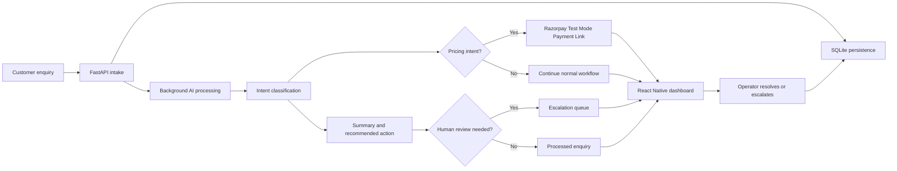

# RevAgent


## From customer enquiry to revenue action

RevAgent is an AI-powered revenue operations agent for small and medium-sized businesses. It turns unstructured customer enquiries into structured, traceable business actions.

The system receives an enquiry, classifies its intent, generates an AI summary and recommended action, and persists the result in an audit trail. When the intent is pricing, RevAgent can generate a real Razorpay Payment Link in Test Mode. When confidence is low or a conversation needs judgment, the enquiry can be escalated to a human operator through the dashboard.

> **RevAgent does not stop at describing what should happen. It moves the enquiry toward the next revenue action, while keeping a human in the loop when the decision is sensitive.**

## Why RevAgent

Many customer-support tools classify, summarize, or draft replies. RevAgent connects that intelligence to an operational workflow:

| Enquiry stage | RevAgent behavior | Business value |
| --- | --- | --- |
| Receive | Accepts an enquiry through the FastAPI API | Creates one entry point for incoming demand |
| Understand | Classifies intent using a TF-IDF and Logistic Regression model | Converts free text into a structured signal |
| Recommend | Stores a suggested response and recommended action | Reduces repetitive operator work |
| Act | Generates a Razorpay Test Mode Payment Link for pricing intent | Moves a qualified conversation toward payment |
| Protect | Escalates a conversation when human review is needed | Prevents sensitive cases from being handled blindly |
| Learn and trace | Records decisions and actions in enquiry history | Makes the workflow explainable and auditable |

## Product flow



## Core capabilities

### AI-driven enquiry processing

The backend uses a TF-IDF and Logistic Regression classifier to identify enquiry intent, including pricing, booking, complaint, and general enquiries. For each processed record, RevAgent stores the classification, confidence, summary, recommended action, and suggested response.

### Agentic commerce with Razorpay

For pricing intent, the backend calls the Razorpay Payment Links API and stores the resulting link on the enquiry record. The current implementation uses Razorpay **Test Mode**, so no real customer payment is collected during the demo.

### Human-in-the-loop escalation

RevAgent is designed to automate routine handling without pretending that every decision should be autonomous. Operators can inspect an enquiry, review the AI context, escalate it for review, or take over and mark it as resolved. These actions are recorded in the enquiry history.

### Live operations dashboard

The React Native and Expo frontend can run in browser or mobile-compatible Expo environments. In live mode, it loads records from the backend API, refreshes periodically, shows pipeline movement, highlights escalations, exposes AI context, and opens generated payment links directly from an enquiry.

If the backend is unavailable during local development, the frontend uses a clearly indicated demo-data fallback so the interface does not fail silently.

## Architecture

### Backend

| Layer | Technology | Responsibility |
| --- | --- | --- |
| API | FastAPI | Enquiry intake, listing, escalation, resolution, history, and health checks |
| Processing | FastAPI `BackgroundTasks` | Runs AI classification and payment-link generation after intake response |
| ML | TF-IDF + Logistic Regression | Predicts enquiry intent and confidence |
| Persistence | SQLAlchemy + SQLite | Stores enquiries, AI results, payment links, and history |
| Commerce | Razorpay Payment Links API | Creates Test Mode payment links for pricing intent |
| Observability | Python logging with JSON formatter | Records enquiry processing and action events |

### Frontend

| Area | Technology | Responsibility |
| --- | --- | --- |
| UI | React Native | Shared interface for phone and web |
| Runtime | Expo SDK 56 | Local development and browser preview |
| Navigation | React Navigation | Home, Leads, Alerts, and enquiry details |
| Data connection | Fetch API | Loads live enquiries and sends operator actions |
| UX | Responsive layouts, status states, animations | Makes pipeline health and next actions easy to understand |

## Frontend experience

The interface is intentionally compact and operational rather than a generic CRM template.

- **Home** shows pipeline pulse, total leads, escalations, recent agent activity, and the current human-attention queue.

- **Leads** provides search, status filters, channel context, urgency markers, summaries, and enquiry details.

- **Alerts** provides an action-focused queue for escalated conversations.

- **Details** shows the original message, AI summary, classification, confidence, recommended action, suggested response, history, and payment link when available.

The `LIVE` indicator pulses when the interface is active. The frontend also exposes whether it is connected to the backend or operating in demo fallback mode.

## API surface

| Method | Route | Purpose |
| --- | --- | --- |
| `GET` | `/` | Confirms that the API is running |
| `GET` | `/health` | Returns backend health and database status |
| `GET` | `/enquiries` | Returns all enquiries for the dashboard |
| `POST` | `/enquiry` | Creates an enquiry and starts background processing |
| `POST` | `/enquiry/{id}/follow-up` | Records a follow-up request in the enquiry history |
| `POST` | `/enquiry/{id}/escalate` | Escalates an enquiry with a reason |
| `POST` | `/enquiry/{id}/resolve` | Marks an enquiry as resolved by an operator |
| `GET` | `/enquiry/{id}/history` | Returns one enquiry with its stored history |

## Project structure

```
CLOSIRA FULLSTACK/
├── Backend/
│   ├── app/
│   │   ├── main.py          # FastAPI routes and background workflow
│   │   ├── classifier.py    # Intent classifier and AI summary logic
│   │   ├── database.py      # SQLAlchemy model and SQLite setup
│   │   ├── payments.py      # Razorpay Payment Links integration
│   │   ├── revagent.db     # Local SQLite database created at runtime
│   │   └── .env             # Local Test Mode credentials; never commit
│   └── requirements.txt
└── Frontend/
    ├── App.js               # Expo / React Native interface
    ├── mock/data.js         # Demo fallback records
    ├── package.json
    └── app.json
```

## Setup

### Prerequisites

Install Python 3.11 or newer, Node.js with npm, and an active Razorpay Test Mode account if you want to demonstrate payment-link generation.

### Backend

From the project root, create and activate a virtual environment:

```bash
cd Backend
python -m venv .venv
```

On Windows PowerShell:

```
.venv\Scripts\Activate.ps1
```

On macOS or Linux:

```bash
source .venv/bin/activate
```

Install the backend dependencies:

```bash
python -m pip install fastapi "uvicorn[standard]" sqlalchemy scikit-learn razorpay python-dotenv
```

Create `Backend/app/.env` with Razorpay **Test Mode** credentials:

```
RAZORPAY_KEY_ID=your_test_key_id
RAZORPAY_KEY_SECRET=your_test_key_secret
```

Start the API from `Backend/app`. Running from this directory ensures the relative SQLite path points to `Backend/app/revagent.db`:

```bash
cd app
python -m uvicorn main:app --reload
```

The API will be available at [`http://127.0.0.1:8000`](http://127.0.0.1:8000).

### Frontend

Open a second terminal:

```bash
cd Frontend
npm install
npx expo install @expo/vector-icons
npm run web
```

The frontend is configured to use:

```
const API_BASE_URL = "http://127.0.0.1:8000";
```

For local browser testing, keep the backend and frontend terminals running at the same time.

## Live demo: one-minute path

The clearest demonstration is an enquiry moving through the complete system:

1. Open [`http://127.0.0.1:8000/docs`](http://127.0.0.1:8000/docs).

1. Use `POST /enquiry` to create a pricing enquiry, such as: `I want to know the pricing for the premium plan`.

1. Wait for the background worker to classify the message.

1. Open `GET /enquiries` or the RevAgent Leads screen and show the real database record.

1. Open the enquiry details and point out the AI classification, confidence, suggested response, and Razorpay payment link when generated.

1. Use `POST /enquiry/{id}/escalate` or the Alerts screen to move the conversation into human review.

1. Press **Take over** in the frontend.

1. Show that the escalation count changes from `1` to `0` and the record becomes `resolved`.

### Suggested pitch narration

> “RevAgent is an autonomous revenue agent for customer enquiries. It receives an unstructured message, understands the intent, recommends the next action, and can create a Razorpay payment link when the customer is asking about pricing. When the model is uncertain or a conversation needs judgment, RevAgent pauses and brings in a human. The important part is that the entire journey is persisted and auditable.”

## Engineering decisions and trade-offs

### FastAPI BackgroundTasks instead of a distributed queue

For this MVP, `BackgroundTasks` keeps the intake endpoint responsive without requiring Redis, Celery, or another queueing service. This reduces setup complexity and makes the project easy to run locally. The trade-off is that the worker runs inside the API process and is not a durable distributed job system; a production deployment would use a dedicated queue and worker architecture.

### SQLite instead of a hosted database

SQLite keeps the project portable and makes the demo reproducible with minimal infrastructure. A production version would move persistence to a managed database and add migrations, backups, stronger validation, and multi-user access controls.

### Live API with a demo fallback

The frontend prefers real API data and refreshes periodically. If the local backend is unavailable, it uses demo records and visibly indicates demo mode. This makes the presentation resilient while keeping the live path honest.

### Test Mode payment action

Payment links are created only for the classifier’s `pricing` intent and use Razorpay Test Mode. In the current MVP, the classifier’s intent result is the primary gate for the payment-link attempt. A production version should add an explicit confidence threshold and a policy check before any money-facing action.

### Development CORS

CORS is permissive for local browser development. Before deployment, `allow_origins=["*"]` should be replaced with the exact deployed frontend origin, and credentials/authentication policies should be configured explicitly.

## Current limitations and next steps

RevAgent is intentionally an MVP. The current version does not yet include authentication, role-based access, durable background jobs, production database migrations, webhook reconciliation for payment status, or a hosted deployment configuration. These are the next engineering steps for turning the demo into a production service.

The current API also accepts several values as query parameters for simplicity. A production API would use validated Pydantic request and response schemas, stricter error handling, rate limiting, and structured event identifiers.

## Security notes

- Use Razorpay Test Mode credentials only during local development and demos.

- Never commit `.env`, API keys, payment secrets, or generated private credentials.

- Restrict CORS before deploying publicly.

- Treat AI output as an assistive recommendation until it passes the product’s confidence and policy checks.

- Do not use the current SQLite and in-process background worker setup as a production security or reliability boundary.

## Author

**Bhanvi Singh Chauhan**  
AI & Full-Stack Developer  
[LinkedIn Profile](https://www.linkedin.com/in/bhanvi-singh-chauhan-2394472b4)
